# Fleet Manager — architecture and design

This document records the architecture present in the repository. Update it with every feature or change that alters components, trust boundaries, API contracts, data ownership, persistence, external integrations, or user navigation. The diagrams describe the current system, not a target architecture.

## 1. System at a glance

Fleet Manager is a browser-based React single-page application, a Python FastAPI HTTP API, and MongoDB persistence. The API also writes upload bytes to local disk and can call Google Maps from the browser and WheelsEye from the backend when configured.

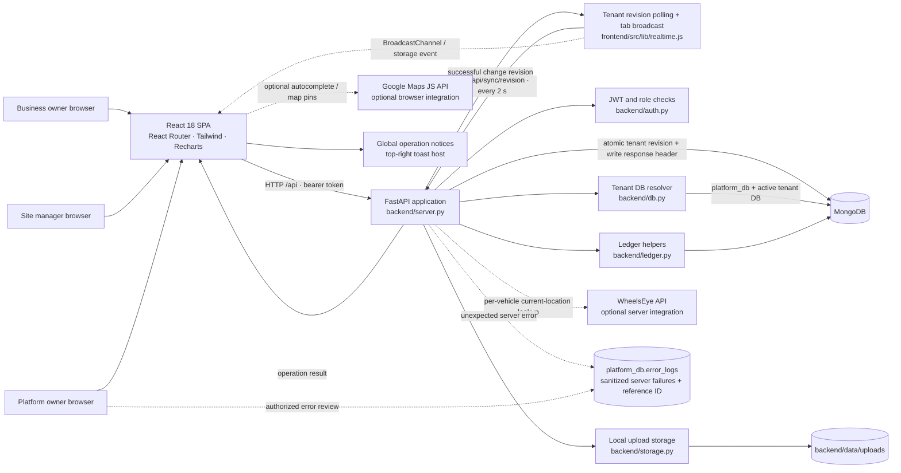

### Repository map

| Path | Responsibility |
|---|---|
| `backend/server.py` | FastAPI app, `/api` routes, request middleware, settings defaults, request orchestration, reporting and aggregation. |
| `backend/site_ops.py` | Additive multi-site API: owner/manager authorization, site/trip/LR operations, booking board data, trip expenses, payments, audit, migration, and staged ledger reconciliation. |
| `backend/auth.py` | Password hashing/verification, JWT issue/verification, user seeding, authenticated-user lookup, platform-role dependency. |
| `backend/db.py` | MongoDB client and platform DB, tenant database naming/context, ID/date/serialization helpers. |
| `backend/ledger.py` | Ledger/cashbook postings, reversals, statements and derived balances. |
| `backend/storage.py` | Tenant-scoped local upload paths and file read/write helpers. |
| `backend/requirements.txt` | Python backend runtime dependencies. |
| `backend/tests/` | API-level multitenancy, auth, business-report and platform tests. They require a reachable configured API. |
| `frontend/src/App.js` | Login state, role-dependent routes and app shell composition. |
| `frontend/src/components/` | Shared layout, controls, forms, location picker and quick-entry UI. |
| `frontend/src/pages/` | Dashboard, business modules, profiles, login, platform console, Bookings Window Board/site administration, trip/LR operations and print views. |
| `frontend/src/lib/` | Axios API client with operation feedback, fetch/master hooks, formatting and exports. |
| `frontend/src/lib/realtime.js` | Tenant-scoped browser tab notification and active revision polling for cross-device data refresh. |
| `frontend/package.json` | React toolchain/dependencies and frontend package version. |
| `scripts/smoke.py` | Manual end-to-end smoke flow against a running backend. |
| `memory/PRD.md` | Product requirements/history and backlog; validate it against current code before treating backlog items as current behavior. |

## 2. Browser navigation and role design

`frontend/src/App.js` loads `/api/me` using a current-tab support token when one exists, otherwise the normal `fms_token`, then selects the route set by role. `Layout` provides the shared navigation, quick-entry actions, global search, branding, and logout. Customer subscription entitlements and per-admin grants filter visible navigation; guarded routes redirect to the first granted section. Platform users normally receive only platform routes. Business admins need both an individual grant and a customer subscription entitlement. Site managers remain scoped to assigned sites and are blocked from Booking when the customer's plan excludes it. A platform owner can explicitly enter a tenant-bound support session; that session runs the existing business-owner routes with full access while preserving the platform login and denying platform-administration routes. The booking workspace groups Dashboard, Trips, Receipts and Ledger; Finance, Audit and Booking Settings remain separately granted for normal customer accounts. Trips and LRs share `/trips` with a `tab` query parameter.

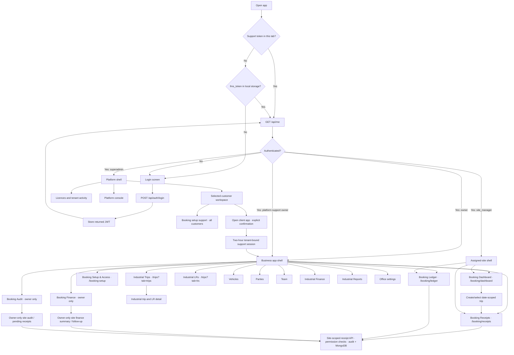

The frontend API client in `frontend/src/lib/api.js` uses `REACT_APP_BACKEND_URL` with `/api` appended, sends the current-tab support token ahead of the normal platform token, and clears only the expired support token on a support-session 401. The platform login remains in local storage and is restored when support ends. `useFetch` and `useMaster` in `frontend/src/lib/hooks.js` provide page-level read/reload behavior; pages call the API client for mutations.

### Platform support-session data flow (v1.27.0)

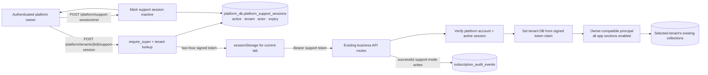

`POST /api/platform/tenants/{tid}/support-session` is platform-owner-only, accepts no client-supplied permission or tenant context, records session start, and returns a token, session ID, selected tenant and expiration. `POST /api/platform/support-session/end` verifies the token, records the end and revokes the active session. The signed tenant claim—not a request header—selects the database; each request also confirms that the issuing platform account is still active and the session is not revoked. The effective owner-compatible principal has all app grants/features regardless of the tenant subscription or licence state, but platform-administration routes still reject it. It carries a separate `platform_support` actor role for records that support actor metadata. The middleware records each successful write's method, route, actor, tenant and session in customer history, without storing request bodies; data revision updates use the support tenant. The customer's saved grants, subscription, license, user role and credentials are not changed.

**Platform directory performance:** `/api/platform/summary` retains its existing tenant, statistic and total response shape. Independent collection counts, revenue aggregation, last-trip lookup, and admin listing for each tenant run concurrently; tenant workloads are guarded by a semaphore capped at 12 clients, avoiding the former per-client sequential query chain without unbounded fan-out. Customer app data loads from its ordinary page endpoints after the support session starts.

Booking Dashboard, Receipts and Ledger call site-scoped endpoints and display only canonical booking records. Industrial Trips, LRs, Finance and Reports use owner-only business APIs and do not request site booking records. Legacy booking URLs redirect into the new workspace; no historical site-trip or site-LR records are moved or duplicated.

### Presentation architecture and design view (27 September 2026)

The visual foundation is shared across routes and uses the existing light palette. `frontend/src/index.css` defines CSS design tokens and common component/accessibility behavior; `frontend/tailwind.config.js` maps Tailwind theme colors and elevation to those tokens; `Layout.jsx` composes role-aware desktop/mobile navigation; shared controls live in `components/ui.jsx`. `Booking.jsx` owns the compact booking workspace. `SiteConsole.jsx` continues to provide site operations and owner-only setup/access at `/booking-setup`, including site creation, manager permissions and booking categories. The owner dashboard response includes a bounded, read-only daily trip/LR count series derived from its site/date/trip filters.

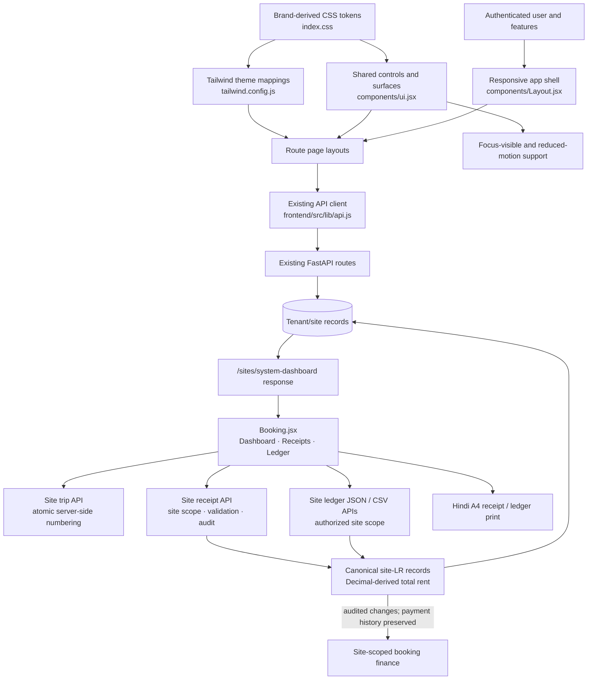

Design implementation notes:

- The existing forest-green, amber and neutral colors are retained as CSS variables; this adds no dark theme or new palette.
- Depth is provided by restrained CSS elevation and layered surfaces. No WebGL/3D renderer or new runtime dependency is introduced.
- Booking screens use canonical site trips/LRs. The shared authenticated shell shows a live Asia/Kolkata clock. Hindi input support is offline and stores source text separately from editable Hindi values. Each goods row stores independent Bhada/Hamali amounts, and receipt-level totals are derived server-side from those row amounts. Blank per-good charge input is normalized to zero; UI fields start at whole rupees but accept up to two fractional digits. Branded Hindi LR prints show each row's Bhada, Hamali and total plus receipt totals and the receipt's persisted creation timestamp rendered in IST. The ledger selects one trip for the chosen date and presents Hindi, read-only receipt details in a spreadsheet-style grid; only Bhada and Hamali are editable by users with charge permission. Creator attribution shows Admin/Manager and name, without exposing login IDs. Booking receipt phone values must be exactly ten ASCII digits when present.
- Same-day similar-receiver conflicts return a structured `409` message and candidate identities. The receipt form lets the manager confirm an existing receiver or explicitly create a different identity, then retries with the selected identity; API errors with structured messages are surfaced rather than replaced with a generic request failure.
- Legacy dashboard analytics and report APIs remain available to their existing consumers. The owner-only Booking Finance and Audit pages use site-scoped summary and audit APIs; they do not call industrial Finance/Reports endpoints. Booking Finance sums active LR Bhada + Hamali for grand total and separates Bhada collections/outstanding from informational Hamali.
- The new ledger edits canonical `site_lrs` records through the scoped LR update API. Owners can correct posted/closed receipts with an audit reason; receiver corrections transfer remaining Bhada balances, and void corrections reverse posted payments and charge postings. Owners can restore mistakenly voided receipts with a reason using compensating postings, retaining original void/payment history. The owner ledger settlement checkbox records remaining Bhada as a Cash payment and reverses only settlements made through that checkbox; Finance can settle grouped receiver balances. These payment events remain append-only and audited.
- Booking `.xlsx` exports are scoped to the selected trip; Hindi goods and quantities are comma-separated per receipt, and financial amounts remain numeric cells with currency formatting. Export formula-like text remains escaped.
- Successful authenticated API writes increment an atomic per-tenant revision in `platform_db.data_revisions`; revision documents contain only a counter and timestamp, never booking or industrial business data. The authenticated, uncached `GET /api/sync/revision` returns only the caller's tenant counter. The response includes `X-Data-Revision`, exposed by CORS, so the writer's browser can notify other same-business tabs immediately. Other devices poll the counter every two seconds while the page is visible; a changed revision dispatches `fms:refresh`, which reloads active `useFetch` queries and direct-fetch operational pages. Tabs use tenant-named `BroadcastChannel` with a storage-event fallback. Existing app modules remain the source of canonical data; updates do not reload the document or create data copies.
- The additive dashboard response field does not change authorization, stored data, financial calculations, or the separate canonical office and site trip/LR collections.
- Global reduced-motion styles honor `prefers-reduced-motion`; mobile layout and navigation are implemented in the shared shell.

### Booking workflow replacement (29 September 2026)

The former booking dashboard, trip/LR detail pages and Booking Reports navigation are replaced for managers by a three-screen workspace: date-scoped Dashboard, trip-context Receipts, and a trip-scoped, spreadsheet-style Ledger. Business owners additionally have owner-only Booking Finance and Booking Audit pages. The site-LR schema additively accepts optional sender/city and per-goods descriptions; historical sender-phone and goods/container values remain intact. Receipt printing is an isolated branded A4 Hindi layout. Ledger export is a server-generated OpenXML `.xlsx` workbook using `openpyxl`; each selected-trip receipt occupies one row, with Hindi goods and quantities comma-separated. CSV APIs remain for compatibility. This is not a historical-data migration: records remain in `site_trips` and `site_lrs`. Trip and receipt sequence generation, idempotency, site authorization, charge permissions, lifecycle guards and audit events remain server-enforced. Total rent is recalculated server-side as Bhada + Hamali. No industrial module, collection or route is removed.

## 3. Authentication and tenant request flow

The platform database is `<DB_NAME>_platform`. It stores `users`, `tenants`, and platform error logs. Each authenticated business request checks the associated licence is active and sets a `ContextVar` to the tenant's database name. The `db` proxy resolves subsequent business collection access against that context.

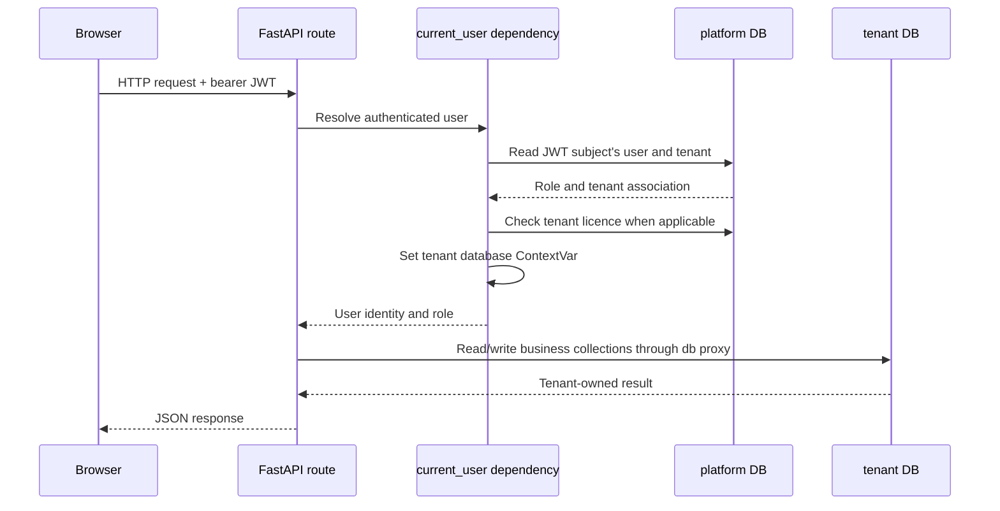

Authentication facts:

- New site-manager password hashes use SHA-256 pre-hashing followed by bcrypt so bcrypt's 72-byte input boundary does not truncate long passwords; legacy direct-bcrypt hashes remain verifiable. Other account password-hashing behavior is unchanged. JWTs use HS256 and the configured `JWT_SECRET`; the current token expiry is 30 days.
- Site-manager passwords are never recoverable from storage: owner assignment/reset requests store hashes, and `/sites/managers` returns manager IDs, status and access grants without password fields. New manager passwords are SHA-256 pre-hashed before bcrypt; legacy direct-bcrypt hashes remain verifiable. The password must be non-empty but has no configured minimum/maximum password-length policy; short passwords are still weak. The owner UI holds a just-entered temporary password in component memory only long enough to copy it after assignment/reset; it does not persist that value, and the owner must reset the credential if it is lost.
- `current_user` looks up the principal and permits only the `owner` role for industrial business endpoints, then uses its tenant context.
- `site_user` resolves the principal for identity and site APIs; site routes enforce owner/site-manager role, tenant, site assignment and action scope. `/api/me` identity resolution remains available to site managers.
- `/api/platform/...` routes use `require_super`, which independently resolves and permits only a normal `superadmin` token; ordinary platform logins do not receive tenant business API access. The explicit support-session token is separately tenant-bound and is denied platform-administration routes.
- For owner requests, `current_user` and the owner branch of `site_user` also pass the HTTP request path through `backend/access_control.py`. That shared policy classifies API paths and checks the individual admin's grant; an unclassified business route fails closed. `/api/me` and tenant sync revision remain available for session setup and live refresh.
- `/api/health` is outside the `/api` router. Login and static file retrieval do not require `current_user`; review file exposure implications before changing upload behavior.
- Customer subscription entitlements (`tenants.subscription_access`) and admin section grants (`users.admin_access`) are independent limits: an owner needs both. Legacy tenants without a saved subscription map retain their prior feature-cap behavior until assigned a subscription. Site managers require Booking to be included in the tenant subscription; site/action grants continue to impose additional restrictions.

### Platform-managed business-admin access

**Platform workspace and audit recorded 10 October 2026 (v1.22.0):** The platform-owner UI separates the client directory, plan catalogue and platform settings. A selected customer has Overview, Subscription, Users & access and Change history tabs; its admin accounts are selected individually before grants are edited. Subscription, admin grant, licence status, plan-template and password-reset mutations append an audit event to `platform_db.subscription_audit_events`. Customer history is queried by tenant ID, while global recent activity is superadmin-only. Event details never contain entered password values.

**Platform management UI refresh recorded 10 October 2026 (v1.23.0):** The client directory now presents searchable, status-filtered customer rows that open the existing customer workspace. User grants can be drafted from an all-included subscription preset, with individual entitlement groups collapsed into count summaries until opened. These are presentation and client-side draft conveniences only: API contracts, subscription snapshots, admin grant persistence, audit behavior, and server-side authorization are unchanged.

**Platform customer operations recorded 10 October 2026 (v1.24.0):** The platform client directory can derive an attention view from the current summary response (expiring/expired or suspended licence, no assigned plan ID, or no active admin). A renewal shortcut opens the existing customer subscription editor and persists the owner-selected expiry through its existing subscription API; suspension now asks for confirmation. Built-in admin access profiles are client-side drafts that are clamped to customer entitlements and features before the existing grant-save API. No new storage, API contract, billing integration, or tenant workflow was added.

**Platform owner usability refresh recorded 10 October 2026 (v1.25.0):** The existing client route opens with its attention filter active; the All customers filter remains directly available. Recommended row actions and the visual licence lifecycle are derived from the existing `/platform/summary` tenant fields. Access profiles include their human-readable grant preview in the client UI; profile selection continues to create a local draft constrained by the subscription and feature map, saved through the existing admin access endpoint. No backend, persistence, or billing changes.

**Platform subscription editor display fix recorded 10 October 2026 (v1.25.1):** Shared modals render through a portal attached to `document.body`, avoiding fixed-position clipping and containing-block behavior from animated page ancestors. The dialog panel is viewport-height constrained with a minimum-height-zero flex scroll region; the subscription editor also uses a wider layout and clearer section hierarchy. Only frontend presentation and dialog semantics change.

**Platform-managed Booking support recorded 10 October 2026 (v1.26.0):** Every selected customer's workspace shows a Booking setup tab. `PlatformBookingSettings.jsx` calls platform-scoped site-operations routes for receipt visibility, sites/configuration/categories, receipt-logo uploads, and site-manager assignment/access/reset/deactivation. Each route independently requires `require_super`, verifies the selected tenant and calls `set_tenant(tenant_id)` before delegating to the established `site_ops.py` handlers. Customer admins may continue to use their own Booking setup; platform access no longer depends on their grant. Site-manager login records remain scoped by tenant ID in `platform_db.users`. No migration, billing behavior, or manager-fee record was added. Temporary generated credentials are returned only by the create/reset response and shown in the browser support page.

**Full client support and summary performance recorded 10 October 2026 (v1.27.0):** A customer-workspace action creates an auditable, two-hour, revocable support session, then reuses the normal app screens under a support-marked owner-compatible principal. The tab-scoped token binds the active platform account, selected tenant, and session; it leaves the persistent platform token untouched. Subscription/admin entitlements are elevated only for this session, platform APIs remain denied, and successful writes are attributed to the platform actor in tenant change history and receipt entry labels. Booking setup remains available in every customer workspace and uses separate platform-scoped APIs. Platform summary queries now use bounded concurrency while keeping their response payload. No customer grants or business records are rewritten to start support.

**Platform management usability and reliability recorded 10 October 2026 (v1.28.0):** The per-customer access workspace selects an active business admin by default and reports effective enabled sections after both subscription and legacy module-feature caps. Global plan-template audit events are labeled as Platform activity, while tenant-scoped events resolve to the customer name. Plan deletion retains the fetched template for its audit record and continues to reject templates assigned to customers.

**Renewal queue and readable audit history recorded 10 October 2026 (v1.29.0):** The platform directory has a Renewals filter for licences expiring within 30 days or already expired; a row action opens the selected customer's subscription editor directly. Customer history formats subscription and individual-admin grant diffs using the section catalog. Subscription audit records count only admins whose saved grants were actually reduced, not every admin inspected during clamping.

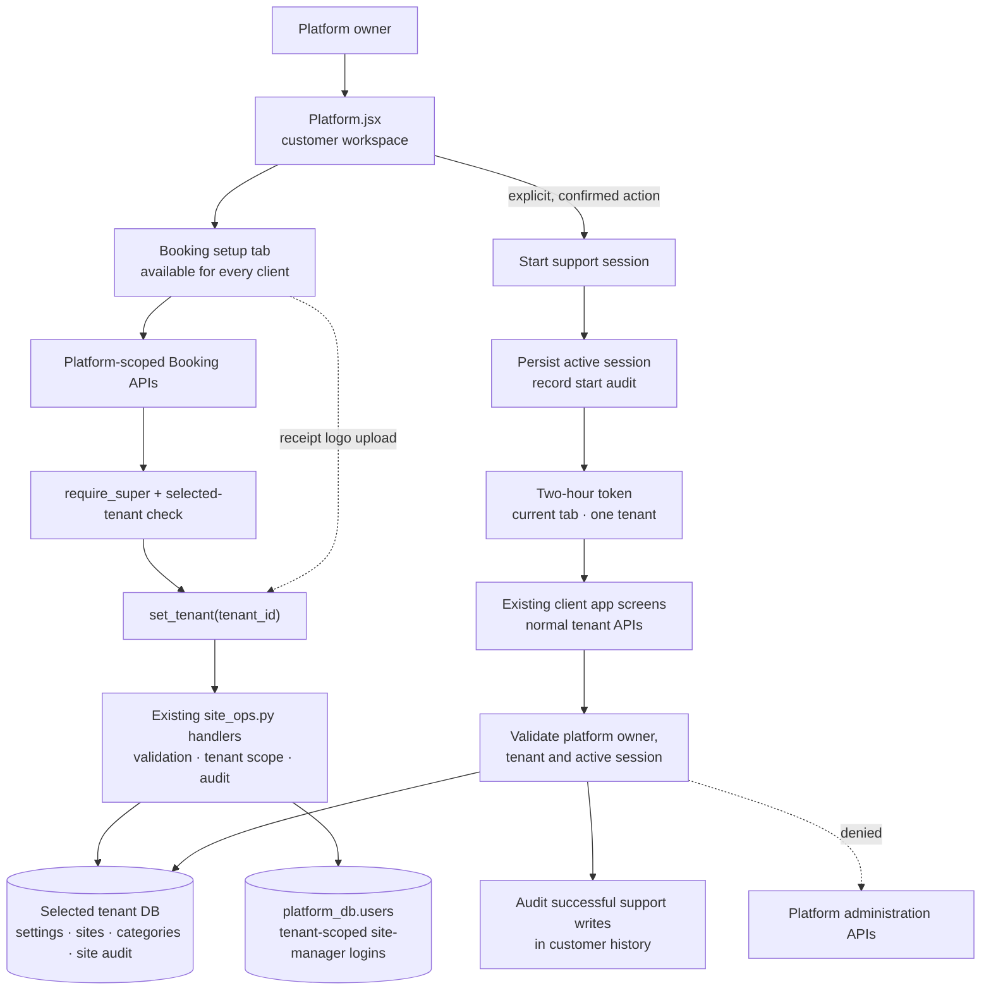

**Subscription controls recorded 10 October 2026 (v1.21.0):** `platform_db.subscription_plans` stores editable plan templates and optional display-only INR monthly/annual prices. Four suggested plans are inserted at first startup when the plan catalogue is empty. New or reassigned customer licences copy the plan name, prices and complete section map into the tenant record; the snapshot is independent of later template edits. Customer-specific changes can be made during assignment. Subscription changes clamp current owner-admin grants, and both browser routes and backend API authorization enforce the tenant cap. Price fields do not trigger billing, and the existing manual Active/Suspended and expiry lifecycle is unchanged.

**Platform client/licence UX recorded 10 October 2026 (v1.20.0):** the platform console now treats each client as the scope for licence configuration and its business-admin access workspace. Search and status filters operate on the tenant directory; access presets only create editable drafts, and saved admin grants continue to be persisted separately on the platform user record.

**Architecture change recorded 09 October 2026 (v1.19.0):** business-owner access now has a platform-controlled grant layer between authentication and tenant route handlers.

`platform_db.users.admin_access` stores the `owner` login's grant map; the platform console selects a business admin, drafts all section grants, and persists the complete map through `PUT /api/platform/tenants/{tenant_id}/admins/{username}/access`. The route validates exact supported keys and boolean values, scopes the target login to the specified tenant, and rejects Industrial grants that exceed the tenant's licence. New business admins are created with every grant disabled. Existing users with no `admin_access` field are treated as legacy allow-all until the platform owner saves an explicit map; once a map exists, missing or false keys deny access.

The frontend's `frontend/src/lib/adminAccess.js` mirrors the grant catalog for navigation, direct-route guards, dashboard sections, and subscription-aware routing. Backend checks remain authoritative. Search results, dashboard summaries, and trip responses also filter nested/aggregate fields, so granting a dashboard or trip page does not automatically expose Finance, LR, Vehicle, or Team content. Trip and LR forms receive only the supporting route/vehicle/driver/party lookup fields necessary to link operational records when the corresponding management module is not granted. Changes apply on the next authenticated request; access revocation does not require issuing a new JWT.

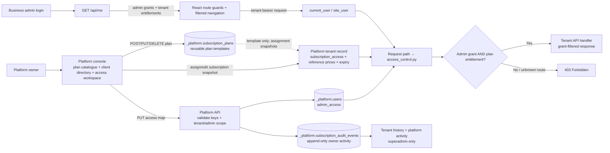

The shared section catalog is: Booking operations (`booking`); Booking Finance, Audit, and Settings (`booking_finance`, `booking_audit`, `booking_settings`); and Industrial Dashboard, Trips, LRs, Vehicles, Parties, Team, Finance, Reports, Tracking, and Settings (`industrial_*`). Subscription plans and customer snapshots use this same complete boolean map; derived legacy tenant features remain an additional cap for Industrial modules.

The platform console presents reusable plans and a searchable client directory with status filters and per-client expiry, assigned plan/prices, activity and admin summaries. Plan edits only affect later assignments. Selecting a client scopes its subscription editor and admin permission workspace; customer subscription snapshots remain on tenant records, while individual grants remain on platform user records. Full Booking, Industrial Trips only and Clear all are UI presets that produce editable drafts, not separate permission rules. A changed admin-access draft must be explicitly saved; switching client/admin prompts before discarding edits. Neither plan checkboxes nor presets override server-enforced subscription caps. Site managers are denied Booking API use when the tenant subscription omits Booking.

### Database placement

| Data | Database | Examples |
|---|---|---|
| Platform users, subscription plans, licences, owner audit history and platform errors | `<DB_NAME>_platform` | `users`, `subscription_plans`, `tenants`, `subscription_audit_events`, `error_logs` |
| Primary tenant's business data | `<DB_NAME>` | Tenant `naidu` maps to base database |
| Other tenants' business data | `<DB_NAME>_<tenant_id>` | Separate tenant collections; tenant IDs are generated from business/owner names with uniqueness suffixes |

Operational collections referenced by the code include `settings`, `trips`, `lrs`, `vehicles`, `drivers`, `team`, `parties`, `fuel_pumps`, `partners`, `receipts`, `handovers`, `expenses`, `fuel`, `payments`, `advances`, `tpl`, `ledger`, `cashbook`, and `files`. Additive multi-site collections are `sites`, `site_trips`, `site_lrs`, `site_counters`, `site_receivers`, `site_categories`, `site_payments`, `site_financial_events`, `site_audit_events`, `site_ledger_imports`, and `site_migrations`. Site-manager identities remain in platform `users`, with a tenant ID, active flag, assigned `site_ids`, and per-site `site_permissions`. Keep collection ownership tenant-local unless a deliberate platform-wide dataset is designed and documented.

### Current data-flow audit (verified in routes and frontend callers)

- **Bookings / site operations:** `Booking.jsx` calls site-scoped trip/LR and ledger endpoints. `site_ops.py` stores receipts in tenant-local `site_trips` and `site_lrs`; identities, references and site authorization remain distinct from industrial records. The XLSX export returns an OpenXML workbook with a receipt-level Ledger sheet and a goods-row Details sheet. Owners may record outstanding Bhada as received per LR or complete a trip ledger; completion posts remaining Bhada through the existing payment ledger and server-locks receipt, payment, and ledger mutations for that trip.
- **Office Trips and LRs:** `TripForm.jsx`, `LRForm.jsx`, `TripDetail.jsx`, `LRView.jsx` and `Trips.jsx` call `/trips` and `/lrs`. `server.py` reads and writes tenant-local `trips` and `lrs`, and their legacy ledger/receipt behavior.
- **Finance and reports:** `/finance/*`, `/reports/*`, search and industrial profiles use legacy/industrial source collections. The shared `expenses`, `ledger` and `cashbook` collections can also contain site-tagged booking postings; industrial balances, statements, cash positions, expenses, trip costs, cashbook views and charts explicitly exclude records with `site_id`. Site dashboard/report paths use site-scoped booking records and tagged expense/posting data; there is no combined company-wide financial read model.
- **Shared masters:** Legacy and site trip resource selectors use the same tenant `vehicles` and `drivers` collections. The site trip-resource endpoint returns the assignable master fields to an owner or to a site manager with `trips:read` or `trips:create`, after verifying assigned-site scope. Vehicle/driver option loading is independent from trip-list/dashboard reads so create-only managers can still assign masters when allowed to create bookings. Site trips retain the selected master IDs plus truck/driver snapshots. Site receiver identity is tracked in `site_receivers`; a related party may be created in shared `parties` with `site_receiver_id`, while legacy sender parties use the same collection without this site identity.
- **Daily booking ledger export:** `/sites/{site_id}/ledger/daily?operating_date=YYYY-MM-DD` reads only the authenticated tenant/site's bookings for that site's operating day, then exports the associated LRs and posted payment/reversal details in a bounded CSV. Owners are allowed; site managers require the explicit site grant `ledger:export`. The permission is included for newly assigned managers by default and can be changed in Booking Setup & Access. The export is read-only and does not use industrial `trips`, `lrs`, or payment collections.
- **People and access:** Office staff/drivers use tenant `team`/`drivers`; site-manager login identities and grants live in platform `users`, scoped by tenant and explicit site permissions. Business owner section grants are also stored on platform user records and enforced in both React and FastAPI. A manager login may reference an Office Team document through `team_member_id`; this does not merge the authentication identity with the Team employee profile or copy credentials into the tenant database. The owner-only Booking Setup & Access register displays manager IDs/status/site assignments; only password hashes are stored, and temporary passwords are displayed in the browser only immediately after assignment/reset. Replacing a manager does not replace operational actor history.
- **Existing legacy-site migration:** `/sites/migration/legacy` only previews records missing `site_id`; its confirmed operation adds `site_id` and `business_id` to the legacy documents. It does not copy or transform `trips`/`lrs` into `site_trips`/`site_lrs`, build ID mappings, or migrate financial events.

Therefore each tenant database contains two active operational trip/LR models with deliberately separate UI and read paths. They are not separate MongoDB databases: operational records use distinct collections, while vehicles/drivers and selected masters are shared. Site financial postings in shared collections are tagged with `site_id`; industrial readers filter them out. No canonical-storage transition or migration is part of this release.

## 4. Business data and money flow

The backend records source documents (trip, LR, receipt, payment, expense, fuel, advance, handover, and 3PL entry) in their domain collections. Financial effects are posted through `backend/ledger.py`. Finance and dashboard endpoints aggregate those records to derive balances and totals.

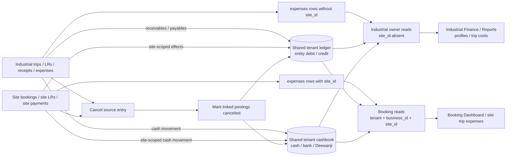

Core accounting conventions in the implementation:

- `ledger`: debits increase a party receivable; credits decrease it. The same ledger supports driver, employee, fuel-pump, and partner balances with entity-specific meanings.
- `cashbook`: `account` is generally `cash`, `bank`, or `deewanji`; `direction` is `in` or `out`.
- A receipt posts a party credit and a cashbook inflow. A handover moves the amount out of Deewanji-held cash and into office cash/bank.
- Fuel on credit and payments affect payables; advances/repayments update person balances.
- Reversal uses `cancelled: true` flags against the source and linked financial postings. Do not hard-delete or manually edit derived balances.
- The UI displays INR and localized date formats; stored dates are generally ISO strings.

## 5. API surface by capability

All business API routes are mounted under `/api`. Most business reads/writes depend on `current_user`.

| Capability | Representative routes |
|---|---|
| Auth and profile | `POST /auth/login`, `GET /auth/me`, `GET /me` |
| Settings and masters | `/settings`, `/masters/{res}`, `/parties/suggest` |
| Industrial Trips and LRs (owner-only) | `/trips`, `/trips/{id}`, `/lrs`, `/lrs/{id}`, `/lr-stats` |
| Site booking operations (owner/site-scoped) | `/sites`, `/sites/{site_id}/trips`, `/sites/{site_id}/trips/{trip_id}/lrs`, and canonical site trip/LR detail routes |
| Transactions | `/receipts`, `/handovers`, `/expenses`, `/fuel`, `/payments`, `/advances`, `/tpl`; cancel operations use `/{id}/cancel` |
| Ledger and entity profiles | `/ledger/{etype}/{eid}`, `/profile/{vehicle|driver|party|employee|fuel_pump|partner}/{id}` |
| Industrial Finance and reports (owner-only) | `/finance/{summary|receivables|payables|cashbook|charts}`, `/reports/{name}`; shared financial reads exclude site-tagged rows |
| Booking dashboard (owner/site-scoped) | `/sites`, `/sites/{site_id}/trips`; selected-date trips and counts |
| Booking receipts and ledger (owner/site-scoped) | `/sites/{site_id}/trips/{trip_id}/lrs`, `/sites/{site_id}/ledger/entries`, `/sites/{site_id}/ledger/export.xlsx` |
| Booking LR updates (owner/site-scoped) | `PATCH /sites/{site_id}/trips/{trip_id}/lrs/{lr_id}`; audited canonical LR update, charge permissions and stale-edit guard |
| Search, reports, documents | `/search`, `/reports/{name}`, `/upload`, `/files/{path}` |
| Tracking integration | `/tracking/live` (WheelsEye tokens are configured per vehicle) |
| Platform owner | `/platform/{summary|tenants|errors}`, `/platform/tenants`, `/platform/tenants/{id}`, `/platform/tenants/{id}/reset-password` |

`backend/server.py` owns legacy routes and mounts the additive site router from `backend/site_ops.py`. `auth.py`, `db.py`, `ledger.py`, and `storage.py` are supporting modules. When extracting routes into routers or adding a new service, preserve the auth dependency, tenant context, financial posting/cancellation behavior, and tests.

## 6. Design and feature map

The daily site-booking interaction is a short Dashboard → Receipts → Ledger flow: select a date and trip, create Hindi-printable receipts under it, then review/edit/print/export the ledger. This remains separate from industrial trip, LR, finance and report workflows. The responsive shell supports desktop navigation and compact mobile navigation/quick actions.

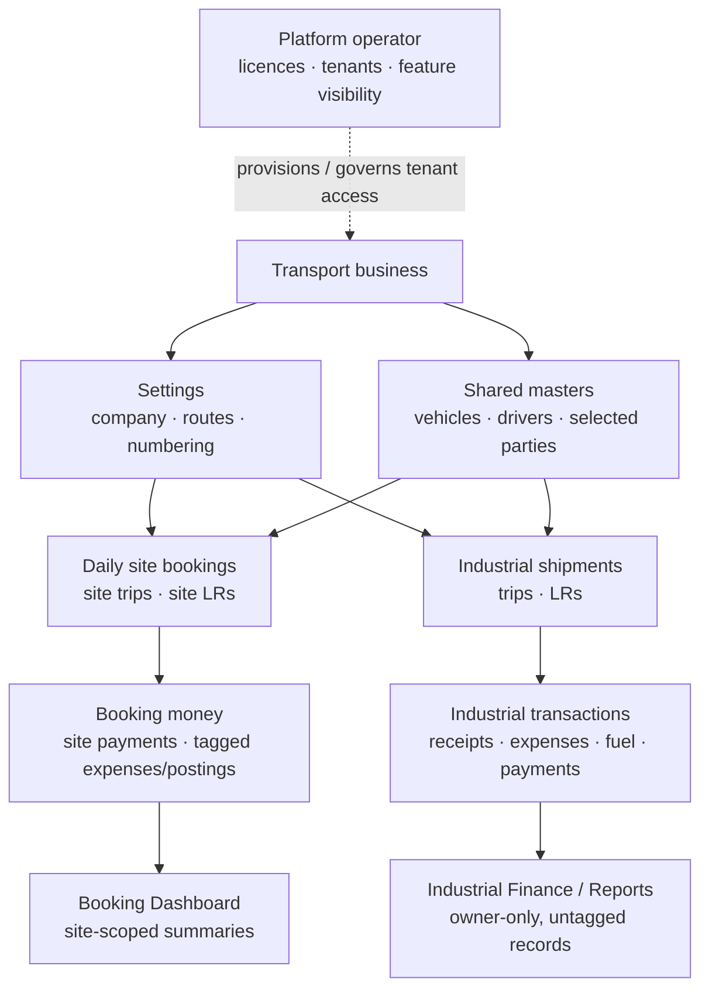

### Frontend screens

- `Booking.jsx`: role-aware Dashboard, Receipts and Ledger workspace; includes optional sender, per-good description, editable Hindi, branded A4 receipt printing, inline autosave with stale-version protection, mobile receipt cards, closed-trip locking and XLSX export.
- `SiteConsole.jsx`: owner-only site setup/access and manager administration; its legacy operational route redirects to the new booking workspace.
- `Trips.jsx`, `TripForm.jsx`, `TripDetail.jsx`: owner-only industrial trip list, entry, detail, cost/profit and status.
- `LRForm.jsx`, `LRView.jsx`: owner-only industrial LR create/print/share workflows.
- `Vehicles.jsx`, `VehicleDetail.jsx`: fleet list, records and profiles.
- `Parties.jsx`, `PartyDetail.jsx`: customer records, outstanding and ledger.
- `Team.jsx`, `PersonDetail.jsx`: driver/team workflows and balances.
- `Finance.jsx`: owner-only industrial financial categories and entry flows; excludes site-tagged shared ledger/cashbook/expense records.
- `Reports.jsx`: owner-only industrial report selection, filters and exports; does not aggregate site bookings.
- `Settings.jsx`: business configuration and branding.
- `Platform.jsx`: platform licence operations and platform settings.

Shared `components/ui.jsx`, `MasterForm.jsx`, and `QuickForms.jsx` provide common controls/forms. `LocationPicker.jsx` progressively enables map lookup if the optional Google Maps key is configured.

## 7. Runtime configuration and operational boundaries

- Backend reads `MONGO_URL`, `DB_NAME`, and `JWT_SECRET`, plus owner/platform seed credentials from `backend/.env`; use `.env.example` as the template and never commit real secrets.
- Frontend reads `REACT_APP_BACKEND_URL` and optionally `REACT_APP_GOOGLE_MAPS_API_KEY` from its environment.
- Local uploads are stored beneath `backend/data/uploads/`; that folder is ignored by Git.
- CORS is configured in `backend/server.py`. Review allowed origins and credentials together before production deployment.
- The startup handler seeds users/settings and creates a small set of MongoDB indexes.
- Middleware records server-side failures in the platform database; platform owners can inspect `/platform/errors`.
- There is no separate deployment/orchestration layer defined in the repository. README instructions describe local development, not a production deployment or backup/restore procedure.

## 8. Known gaps and architecture cautions

- The API is a large, single `server.py`; keep changes scoped, reuse established helpers, and consider route/module extraction only as a separately reviewed architecture change.
- Feature flags currently hide frontend navigation but are not uniformly checked at backend endpoints.
- Local disk uploads require persistent shared storage and backups if deployed beyond one local machine.
- External integrations require user-provided credentials and must have explicit timeout/error behavior.
- Test setup expects a live API and may use environment paths or ports that differ from this README's local defaults; inspect the fixtures before running tests.
- The in-repo PRD has historical statements and a backlog. Confirm actual behavior in source before extending documentation or promising features.

## 9. Architecture change record

For every architecture-affecting feature/change, add a dated note here stating the changed component/boundary, new data or API flow, compatibility/migration impact, and relevant verification. Keep the diagrams in Sections 1–6 synchronized in the same change set. The release/changelog entry lives in [VERSION.md](VERSION.md).

### v1.1.2 — 27 September 2026

- Recorded the current React → FastAPI → MongoDB architecture, authentication/tenant flow, financial posting model, navigation design, integrations, and known operational boundaries.
- This release documents the existing implementation; it does not introduce an application runtime or data-model change.

## 10. Multi-site transport architecture (v1.2.0)

The multi-site feature extends, rather than replaces, the existing database-per-business tenancy model. It does not introduce a second database or rewrite legacy trip/LR collections. Owner site APIs use `site_user` plus owner-role checks; manager APIs additionally verify tenant, active site assignment, and per-site action permissions on every request. Legacy business APIs continue to use `current_user`, which denies the `site_manager` role. Managers receive no site access unless assigned or explicitly granted by the owner.

### Data and relationship diagram

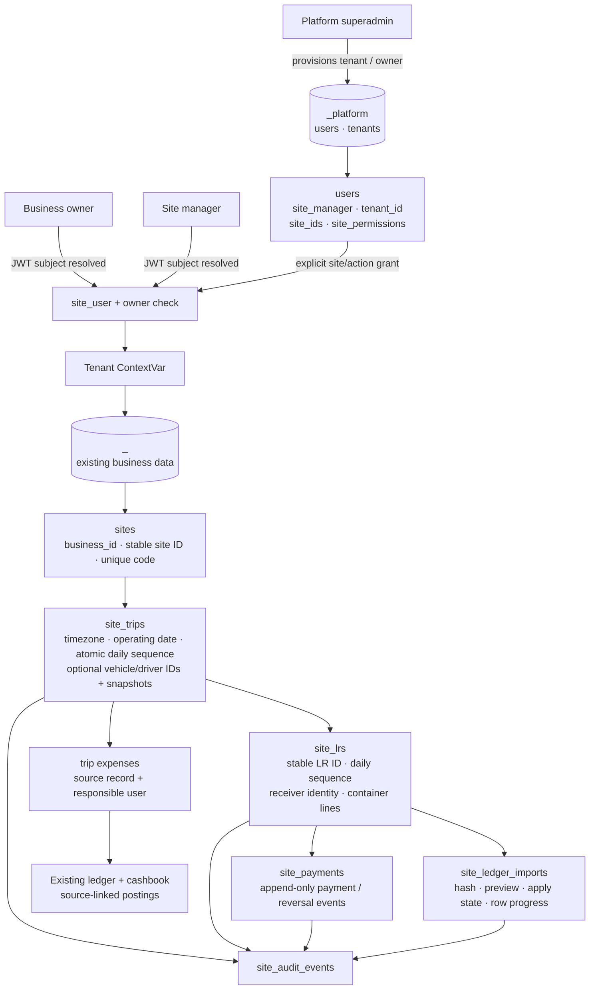

### Authorization request flow

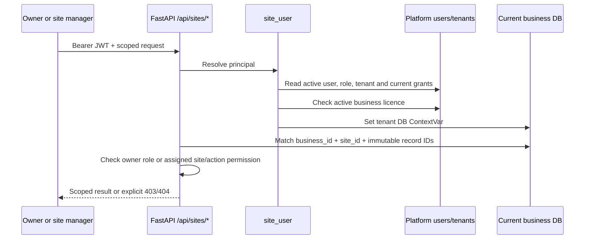

### Trip, LR, ledger and money flow

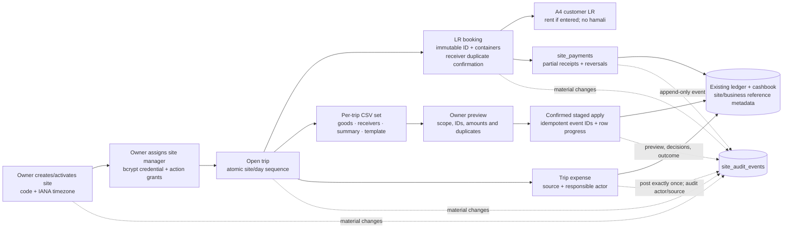

Trip and LR counters use atomic MongoDB increments with unique compound indexes. Trip references are `<SITE><DDMMYYYY>-<NN>`; LR references are `<SITE>LR<DDMMYYYY>-<NN>`. MongoDB IDs remain stable relationships; truck numbers and display labels are attributes, not keys.

### API, money and reconciliation boundaries

- The site router mounted by `server.py` exposes site/manager administration, the Bookings Window Board summaries, authorized tenant vehicle/driver choice data, trip lifecycle and expenses, categories, LR CRUD, payments/reversals, audit history, explicit legacy migration, CSV exports, and import upload/preview/edit/commit/original-download.
- Site queries include authenticated business/site scope at the service/database layer. Manager grants default to no cross-site access. Business-wide dashboards, manager administration, ledger import/export, and legacy migration are owner-only.
- New currency values use `Decimal` in application logic and MongoDB `Decimal128`. The existing `ledger.py` interface accepts floats for postings, so site finance calls the existing helper with optional site/business metadata; balances use Decimal-safe LR and payment records, not browser totals.
- Site trip expenses follow the existing ledger/cashbook source-posting conventions. Preserve tenant/site/trip references and the authenticated recorder on each expense; idempotent source references prevent duplicate posting on retries. Trip liability/accountability is tied to the recorded responsible person and must not be inferred solely from an editable driver label.
- Rent adjustments post deltas through the existing party ledger. Actual payments and owner reversals are separate immutable `site_payments` events linked to LR/trip/site/business. Hamali is a separate recorded charge and is not posted as collected bhada or classified as a cost.
- Site trips, LRs, expenses, payments, manager logins and tenant provisioning retain the creator login ID, name/role snapshot and timestamp. Site audit events retain actor ID/login/role and timestamp; audit history is owner-only, and booking creator metadata is removed from manager-facing responses.
- Ledger interchange uses versioned, scoped CSV files with immutable `lr_id`, `trip_id`, and `site_id` fields. Because CSV has no worksheets, goods-wise, receiver-wise, summary, and import-template files are separate downloads. The parser validates the whole file before preview; the owner resolves row errors, acknowledges missing LRs, and confirms. Imports are file-hash idempotent. Deterministic row events and persisted progress support resuming when multi-document MongoDB transactions are unavailable.
- Report CSVs use a header-first layout with explicit scope and units; the goods summary and per-LR/container goods-detail report serve different grains. Detailed rows do not repeat LR-level monetary totals per container. The versioned import-template alone is accepted for reconciliation; its headers, metadata, and paid-total semantics remain stable.
- Successful/failed frontend mutations use a shared Axios feedback path and top-right toast host. Unexpected backend exceptions receive a reference ID and a sanitized platform error-log entry; do not persist bearer tokens, request bodies, passwords, or other secrets in the log.
- Original ledger files use the private `fleet-manager/<business>/site-ledgers/` path. The unauthenticated legacy file handler rejects this path; an owner-checked API serves originals. The underlying local filesystem storage is not shared durable production storage.

### Migration and indexing

Legacy preview reports records lacking a site assignment in selected tenant-local collections. The owner creates a default site and explicitly confirms migration. Apply fills `site_id` and `business_id` only when `site_id` is missing/null, stores counts and audit metadata, and can repeat/resume without reassigning already-scoped records. It does not silently choose or create a site.

Indexes cover unique business/site codes; unique site/day trip and LR sequences/references; receiver/date lookups; business/site/trip LR and payment access; payment idempotency and reversal keys; category uniqueness; audit/import timelines; and unique site financial posting references. `initialize_site_storage()` creates tenant-local indexes once per active database and for newly licensed tenants.

Configuration change in v1.2.0: `tzdata>=2025.2,<2027` provides IANA timezone data on Windows hosts.

### Known limitations

- Existing businesses need an owner-created default site before previewing and explicitly applying legacy site assignment.
- Scoped CSV remains the interchange/import format; the user-facing booking ledger also exports a formatted multi-sheet XLSX workbook.
- Hamali accounting meaning is unconfirmed; it remains separate from collected bhada, profit and cash flow.
- Original ledger files use the existing local storage provider; production needs private, durable, shared storage and backup/retention controls.
- No live MongoDB integration suite was run for this change in this environment. Offline unit tests and frontend production build are the executed checks; production multi-worker/transaction behavior needs deployment verification.

### v1.2.0 — 27 September 2026

- Added the site/business data and authorization boundaries, manager grants, trip/LR lifecycle, staged ledger/payment flow, migration rules, and deployment limitations described above.

### v1.2.1 — 27 September 2026

- Kept `site_payment_reversal_unique` as a unique sparse index, matching existing tenant DB index metadata so startup can safely reuse it.
- Rejected invalid payment-balance events are explicitly marked and excluded from dashboard/payment aggregates. Owners can retry pending idempotent ledger/cashbook postings; reversals also resume safely after interrupted requests.

### v1.2.2 — 27 September 2026

- Fixed the site document serializer to retain each top-level MongoDB `_id` as API `id`, while continuing to omit nested internal IDs. This restores site listing and dashboard responses.
- Added tenant-scoped trip resource lookup for vehicle/driver selectors; site trip records retain optional source master IDs and immutable truck/driver snapshots, with manual entry supported.
- Added an opt-in destructive-by-design (writes-only) API acceptance test; it is disabled unless pointed explicitly at a disposable test service.

### v1.3.0 — 27 September 2026

- Reframed the owner `/sites` screen as the Bookings Window Board and added site/trip/LR and receiver-/goods-wise outstanding views; added mobile-focused trip/LR screens and optional LR contact phones.
- Added source-linked, idempotently posted site trip expenses using the existing ledger/cashbook conventions, with actor attribution, audit history, and trip/site totals.
- Added immediate LR print navigation through the browser print flow, retaining repeat printing and PDF saving.
- Added operation-specific mutation toasts and reference-linked platform error logging for unexpected server failures and failed writes. Error logs omit request bodies/headers/query strings and redact sensitive fields; login failures and failed reads are not persisted as write errors.
- Reworked report CSVs to use clear headers/scope/units and provide detailed goods/container rows. The existing immutable-ID import template format remains the only accepted reconciliation input. Validation: focused offline tests and frontend build; no live API/MongoDB workflow run.

### v1.3.1 — 27 September 2026

- Changed the site-trip expense idempotency index declaration to match the named partial index already present in deployed tenant databases. This repairs the reported startup failure without dropping/rebuilding the index or changing records.
- Split route page code into lazy-loaded frontend chunks; avoid duplicate Board request cycles and avoid loading legacy trip masters/settings on the LR tab. The compiled application now emits a small entry bundle plus route chunks instead of placing every page in the entry chunk.
- Scoped legacy `/trips` LR, expense, and fuel summary aggregations to the IDs in the requested trip page. Empty pages skip all related aggregation; supporting `trip_id` indexes allow bounded matching. Existing cancellation and financial-total semantics are unchanged.
- Offline tests cover the query filters, totals, empty-page path, index specification, and page-size limits. No live MongoDB latency benchmark was run; production p50/p95 and query plans still need measurement with representative tenant data.
- No storage migration, database reset, or data deletion is required. The existing tenant-per-database boundary and collection schemas are retained.

### v1.4.0 — 27 September 2026

- Added an owner-only, collapsed Site bookings panel to Trips & LR. It loads site lists, paginated trips and trip-scoped LRs on demand through the existing site APIs, and links to their canonical detail/print routes.
- Kept site and office records in their original tenant collections and financial workflows. The owner view does not copy records, mirror mutations, or create duplicate ledger/payment effects; site authorization remains enforced by the existing API.
- Made Booking Dashboard the owner landing/sidebar entry. Its compact KPI row includes filtered trip/LR and financial totals plus active trips and pending reconciliation; quick actions lead into the booking, LR, finance and report workflows. The former `/dashboard` browser route redirects to `/sites`.
- Added a `total_trips` field to the existing filtered site-dashboard aggregation; it is computed from the same matched site trips as the selected date/site/trip/status/receiver filters.
- Grouped detailed dashboard analytics and site/manager/category administration into collapsed sections. Existing site/office collections and financial flows are not unified by this view redesign.
- No API schema or data migration is required. Frontend tests cover lazy loading and canonical trip/LR navigation; live database latency is deployment-specific and was not benchmarked.

### v1.10.0 — 27 September 2026

- Added an expandable in-app trip ledger editor for site-booking LR sender/receiver, goods and container/quantity fields. It uses the existing scoped, audited site-LR update API and canonical MongoDB documents, so booking Finance and Reports read the edited values without a parallel ledger or CSV round trip.
- Owner and `lrs:update` manager access is kept separate from the additional `finance:update` permission required for manager bhada/hamali edits. Closed-trip, reconciliation, posted-payment, receiver-identity and immutable-payment safeguards continue to be enforced by the existing backend.

### v1.11.0 — 27 September 2026

- Added inline LR editing in the owner-only Booking Reports ledger. Receiver, goods, containers/quantities and charges save to canonical `site_lrs` records through the existing site-scoped API; changed rows immediately use server-returned financial values.
- Collections, outstanding and payment status remain derived from append-only payment/reversal events and LR bhada. Receiver identity changes and bhada changes are separate saves to preserve correct party ledger posting.

### v1.12.0 — 27 September 2026

- Booking Reports trip references now open the associated booking header and its full paginated LR ledger inline. Owner edits to LR/contact/goods/container/charge fields update canonical `site_lrs`, not report-only copies.
- Returned LR values and posted payment events drive report and Booking Finance calculations. A first bhada correction submitted with a permitted receiver change posts its financial delta against the newly resolved receiver party.

### v1.13.0 — 27 September 2026

- Added tenant-scoped change revisions for successful API writes and an authenticated, uncached revision endpoint. Active clients poll every two seconds, receive same-business cross-tab notifications, and refresh current data views across booking and industrial workflows without a page reload.
- Revision counters are stored in the platform database separately from tenant business records. Existing tenant collections remain the source of truth for all displayed data and finance.

### Booking receipt print and ledger presentation

- Per-site Booking settings configure English-to-Hindi conversion, print language, sender/receiver address visibility, and the receipt fee. Receipt data entry/editing remains English; Hindi goods descriptions and quantity digits are retained for print/ledger, and the receiver phone is included on the receipt.
- Each new receipt stores the fee configured at creation, and that fee contributes to Booking Finance totals and payment balances. Legacy receipts without a stored fee use the ₹2 fallback. The selected-trip ledger and Excel export combine each good with its quantity in one comma-separated cell; Bhada and Hamali remain the only editable ledger amounts.
- Receipt printing uses the Naidu Goods Transport name and a compact one-page A4 layout.

### v1.7.0 — 27 September 2026

- Added separate owner-only Booking Finance and Booking Reports screens and a tenant/site-scoped paginated LR report API. The dashboard is now operationally focused; detailed financial breakdowns are available in Booking Finance.
- Added the owner LR charge sheet on site-trip detail. Bhada/hamali edits call the existing canonical LR update route, preserving server validation, audit and financial idempotency.
- No booking records were moved, mirrored or newly stored. Site and industrial finance/report sources remain separate.

### v1.6.0 — 27 September 2026

- Removed the site-bookings panel and cross-workflow quick links from industrial Trips/LRs; hid global industrial search and Quick Add controls while on site booking routes. Booking Dashboard/site trip/LR screens and owner-only industrial Trips/LRs/Finance/Reports now have separate navigation and data paths.
- Tightened `current_user` to business owners only; `site_user` continues resolving owner/site-manager identity for `/api/me` and site-scoped routes, while `require_super` independently enforces platform access.
- Site booking expenses and ledger/cashbook postings remain in their existing tenant collections with `site_id`. Industrial read models explicitly match rows where `site_id` is absent; industrial expense cancellation also verifies the source row is unscoped before reversing postings.
- No database, collection, API schema or record migration is introduced. Shared vehicle/driver/master data and existing canonical trip/LR collections remain unchanged.
- Verification: focused offline backend authorization, financial-scope and site-operations tests passed (51); frontend tests passed (15 across 6 suites); production build completed. No live/write-enabled workflow was run because the available local API was not confirmed to belong to this project or a disposable tenant.
